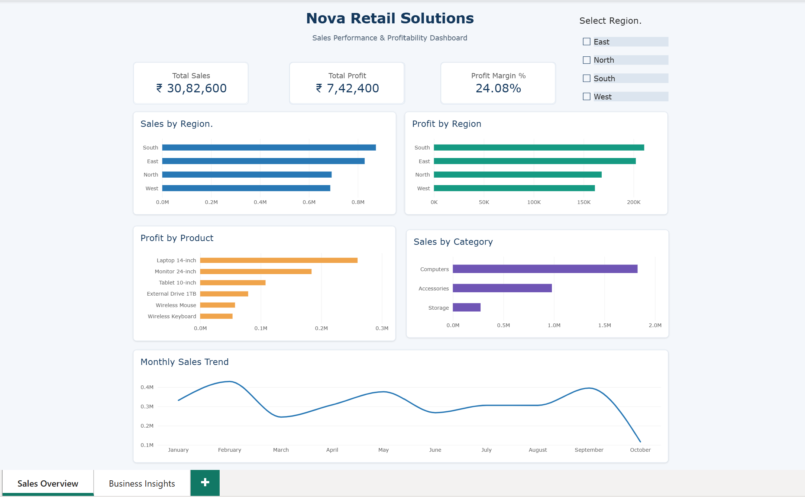
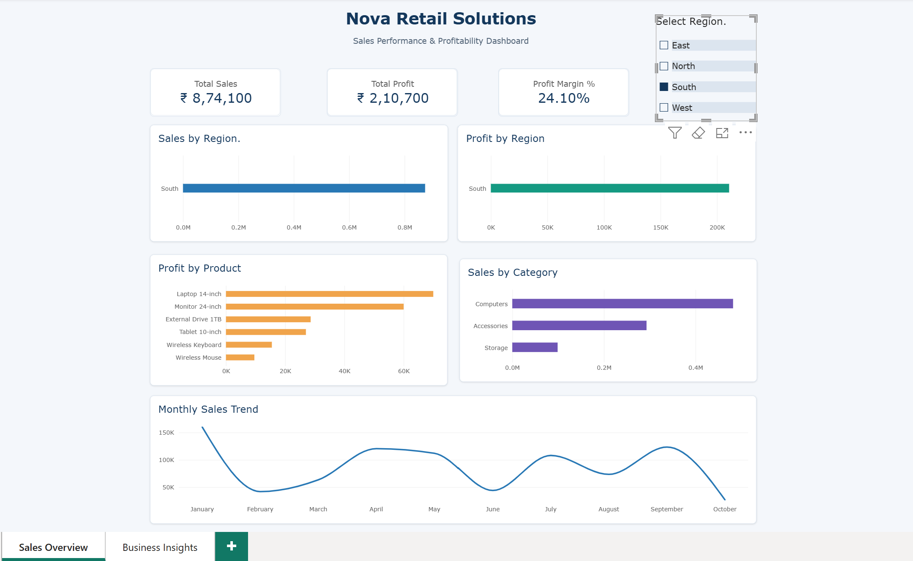
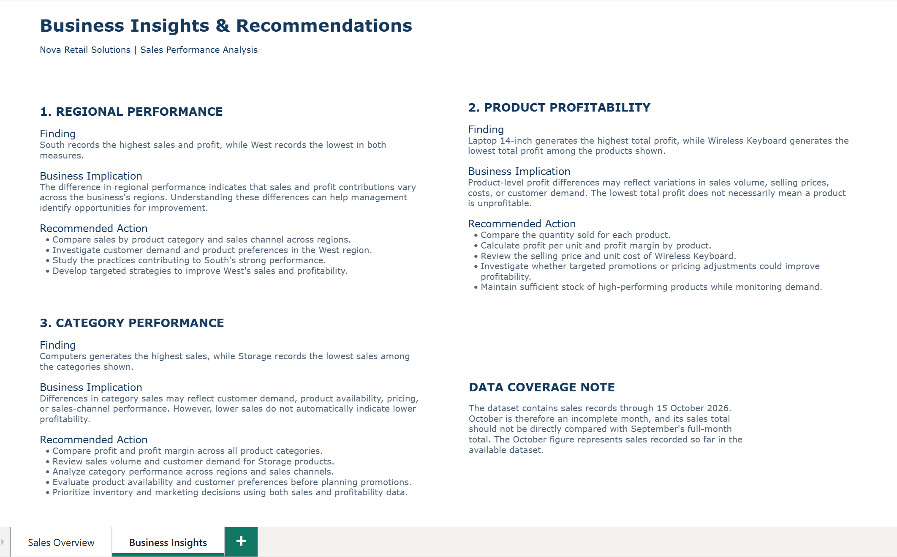

# Nova Retail – Sales Performance & Profitability Dashboard

## Project Overview

This project analyses retail sales performance and profitability using Microsoft Power BI. It transforms fictional retail data into meaningful business insights to support data-driven decision-making.

## Business Objectives

- Analyse overall sales and profitability.
- Understand regional sales performance.
- Track sales trends over time.
- Identify business performance patterns.
- Present actionable insights through interactive dashboards.

## Tools & Technologies

- **Power BI Desktop** – Dashboard development and data visualisation
- **Power Query** – Data preparation and transformation
- **DAX** – Calculated measures and business metrics
- **Microsoft Excel** – Dataset preparation

## Dashboard Highlights

- Sales performance overview
- Regional sales analysis
- Sales trends over time
- Profitability analysis
- Business insights and recommendations

## Dashboard Preview

### Sales Overview – Page 1

### Sales Overview – Page 2

### Business Insights

## Key Learnings

- Data preparation using Power Query.
- Creating DAX measures.
- Designing interactive dashboards.
- Translating data into business insights.

## Project Files

| File | Description |
|---|---|
| Nova_Retail_Sales_Performance_Dashboard.pbix | Power BI report |
| Nova_Retail_Project_Documentation_Revised.docx | Project documentation |
| PNG files | Dashboard screenshots |

## Dataset Information

This project uses a fictional, self-created Excel dataset for portfolio and learning purposes. It does not contain real client or business data.

---

**Project Type:** Power BI Portfolio Project

**Focus:** Sales Analytics | Profitability | Business Intelligence
